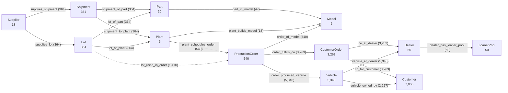

# Ripple Control ontology

Schema `ripple-graph/1.0` · snapshot `9b1551f5b55378ef` · 17,029 nodes · 28,201 edges

Dashed edge = derived (same plant, build date in the lot's inclusive window, model BOM contains the part).

| Edge type | From | To | Meaning | Count |
|---|---|---|---|---|
| `SUPPLIES_SHIPMENT` | Supplier | Shipment | supplier sends an inbound shipment | 364 |
| `SHIPMENT_OF_PART` | Shipment | Part | shipment carries a part | 364 |
| `SHIPMENT_TO_PLANT` | Shipment | Plant | shipment is received at a plant | 364 |
| `PART_IN_MODEL` | Part | Model | bill of materials: model requires part | 47 |
| `PLANT_BUILDS_MODEL` | Plant | Model | plant is able to build the model | 18 |
| `PLANT_SCHEDULES_ORDER` | Plant | ProductionOrder | order is built at the plant | 540 |
| `ORDER_OF_MODEL` | ProductionOrder | Model | order builds this model | 540 |
| `ORDER_FULFILLS_CO` | ProductionOrder | CustomerOrder | customer order is filled by the build | 3,263 |
| `CO_AT_DEALER` | CustomerOrder | Dealer | customer order placed through dealer | 3,263 |
| `CO_FOR_CUSTOMER` | CustomerOrder | Customer | customer order belongs to customer | 3,263 |
| `SUPPLIES_LOT` | Supplier | Lot | supplier produced the part lot | 364 |
| `LOT_OF_PART` | Lot | Part | lot is a lot of this part | 364 |
| `LOT_AT_PLANT` | Lot | Plant | lot was installed at the plant | 364 |
| `LOT_USED_IN_ORDER` | Lot | ProductionOrder | DERIVED: same plant, build date in lot window, model BOM has part | 1,410 |
| `ORDER_PRODUCED_VEHICLE` | ProductionOrder | Vehicle | finished vehicle came from the build | 5,348 |
| `VEHICLE_AT_DEALER` | Vehicle | Dealer | vehicle is allocated to dealer | 5,348 |
| `VEHICLE_OWNED_BY` | Vehicle | Customer | sold vehicle owner | 2,927 |
| `DEALER_HAS_LOANER_POOL` | Dealer | LoanerPool | dealer's loaner pool | 50 |

Every edge stores `source_table` and `source_key` (the CSV row that justifies it). Keys: node `Type:id`, edge `TYPE|src|dst`.
